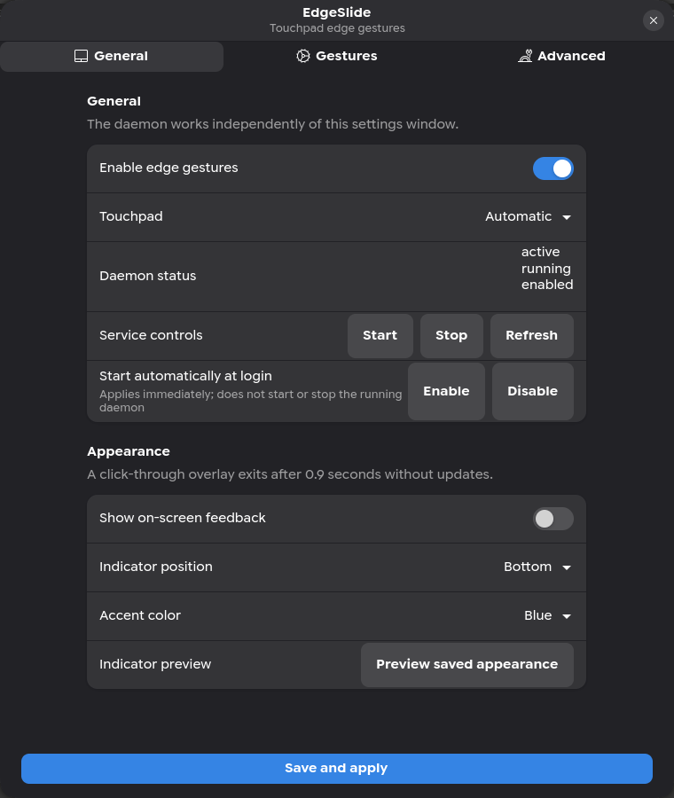
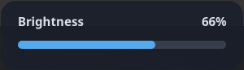

<div align="center">

# E D G E S L I D E

### Small gestures. Everyday control.

Volume, brightness and workspace gestures for Hyprland.<br>
Keep your hands on the touchpad.


[](LICENSE)

[Get started](#get-started) · [Gestures](#gestures) · [Full guide](docs/GUIDE.md) · [Device access](docs/PERMISSIONS.md) · [Verification](docs/VERIFICATION.md)



*Actual application capture · clean libadwaita theme · no settings applied*

</div>

## The edges do a little more.

Slide along a touchpad edge to adjust volume or screen brightness. Add native
multi-finger gestures for workspaces and screenshots, then tune everything in a
compact settings window.

- **Volume and brightness, at your fingertips.** Each edge can be assigned,
  inverted, adjusted or disabled independently.
- **Native multi-finger gestures.** Configure workspace navigation, area
  screenshots and your own commands through Hyprland's Lua gesture API.
- **Settings that get out of the way.** Closing the GTK window exits the GUI;
  enabled edge controls continue in the user service.
- **Feedback when you want it.** An optional click-through indicator shows your
  adjustment, then disappears. Choose its position and accent.
- **Your input stays with Hyprland.** The edge service observes touchpad events
  without grabbing the device. Pointer movement, clicks and scrolling remain
  under compositor control.
- **Start on your terms.** Installation preserves existing configuration and
  leaves autostart off until you enable it.

EdgeSlide runs as your desktop user. Touchpad access is a separate, explicit
setup step; see [device permissions](docs/PERMISSIONS.md).
Hardware-specific cancellation and typing/palm limitations are documented in the
[behavior guide](docs/GUIDE.md#edge-behavior).

## Get started

**Arch Linux and a Hyprland Wayland session.** Clone the project and run the
installer as your regular desktop user:

```bash
git clone https://github.com/es1xx/EdgeSlide.git
cd EdgeSlide
./scripts/install-arch.sh
```

The installer checks for missing build dependencies, requests `pacman` only when
needed, builds the locked Rust workspace, and installs under `~/.local`.
If dependencies are already installed, use `./scripts/install.sh`.
It preserves your configuration and does not enable autostart.

Follow the [device-access guide](docs/PERMISSIONS.md), then open **EdgeSlide**
from your application launcher or run:

```bash
~/.local/bin/edgeslide-settings
```

Start edge controls from the settings window, or:

```bash
systemctl --user start edgeslide.service
systemctl --user enable edgeslide.service  # Optional: start on future logins
```

Other distributions can use the source installer after providing equivalent
dependencies; the convenience dependency installer targets Arch Linux.
See the [setup guide](docs/GUIDE.md#installation-and-lifecycle).

## Gestures

| Gesture | Default action |
| :-- | :-- |
| One finger along the left edge | Volume up / down |
| One finger along the right edge | Brightness up / down |
| Four fingers left / right | Previous / next workspace |
| Three fingers down | Select an area for a screenshot |
| Three fingers up | Your overview command, once configured |

Edge actions and native gestures have separate enable controls.
Multi-finger gestures require opting into the
[Hyprland Lua integration](docs/MULTIFINGER.md), tested with Hyprland 0.57.
They do not become active merely by starting the edge service.

Three-finger up stays disabled until you choose an installed overview provider.
EdgeSlide does not install or assume one. Custom commands, sensitivity and
per-gesture switches are available in **Gestures**.

## A little feedback

<p align="center">

</p>

The optional overlay accepts no keyboard or pointer input and reserves no screen
space. It closes after roughly 900 ms without updates. Preview it in **General**
before enabling it; preview does not change volume or brightness.

## Development

```bash
cargo fmt --all -- --check
cargo clippy --workspace --all-targets -- -D warnings
cargo test --workspace
lua tests/multifinger.lua
```

The verification reports cover automated checks and the touchpad behavior
actually tested on hardware. Idle measurements are observations from one system,
not battery-life guarantees.

See [edge-control verification](docs/VERIFICATION.md) and
[multi-finger verification](docs/MULTIFINGER-VERIFICATION.md).
The [technical guide](docs/GUIDE.md) explains the daemon, cancellation behavior,
backend requirements and removal.

## License

[MIT](LICENSE) · Copyright © 2026 EdgeSlide contributors.

The root MIT license covers the original application and documentation.
Dependencies and referenced protocols retain their respective licenses.
